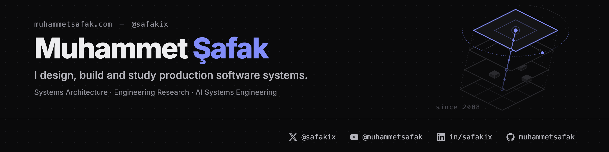

<!--

  

-->

# Hi, I'm Muhammet Şafak

**Software Engineer** — Systems Architecture · Engineering Research · AI Systems Engineering

Staff Engineer at [Bulutklinik](https://github.com/bulutklinik) · Istanbul, Türkiye

---

I've been building software professionally since 2008. I didn't learn it at school — my degree is in history. Over the years I have built large production systems and turned what I learned from them into measured, published research.

Today I work as a **Staff Engineer at Bulutklinik**, on the architecture, scalability and reliability of high-traffic distributed systems. My direction is **AI Systems Engineering**: putting language models into production systems with the same discipline as any other component — explicit contracts, measured behavior and the decision left with a human.

My work spans three connected areas:

- **Software Engineering** — production systems, backend services, APIs and developer tools.
- **Systems Architecture** — distributed and event-driven systems, boundaries, contracts and the trade-offs between them.
- **Engineering Research** — experiments, benchmarks and reproducible measurements of how systems actually behave.

## How I work

1. **I choose what can be changed tomorrow** — reversible technical decisions over clever ones.
2. **I write down why** — every project keeps its decisions as ADRs.
3. **I state the cost** — performance, money and complexity are part of the answer.
4. **I'm bound to the problem, not the language** — PHP, Go, Python and TypeScript sit at the same table.
5. **When I don't know, I write "I don't know."**

On AI: *the machine works at the language layer, not the decision layer.* I use AI heavily — content pipelines, agent-based development, LLM products — and I design the systems so that the final decision stays with a person.

## Engineering focus

| Area | Interests |
| --- | --- |
| **AI Systems Engineering** | LLM gateways, RAG, MCP, agent security and cost, evaluation, self-hosted AI infrastructure |
| **Distributed Systems** | Event-driven architecture, messaging, service contracts, consistency, retries, idempotency |
| **Software Architecture** | System boundaries, DDD, modularity, integration design, decision records |
| **Reliability & Performance** | High availability, caching, database performance, capacity, observability |
| **Developer Infrastructure** | CLI tools, code review, CI/CD, interoperability, open standards |
| **Engineering Research** | Benchmarking, experimental methodology, performance analysis, reproducibility |

## Research

I run independent engineering investigations and publish each one with its methodology, environment, results and limitations. The goal is not to declare winners, but to produce findings others can examine, challenge and reproduce.

Selected reports:

- **[One core carries 14,330 OAuth2 requests in Go and 5,152 in PHP-FPM](https://muhammetsafak.com/research/capacity-per-core-go-php-oauth2/)** — per-core capacity under the same workload.
- **[A partial index makes a queue table forty-one times smaller — for as long as the planner picks it](https://muhammetsafak.com/research/partial-index-queue-table/)** — PostgreSQL on a 10-million-row queue table.
- **[Seven PHP frameworks under identical load](https://muhammetsafak.com/research/php-framework-load-test/)** — the gap narrows as soon as the request does real work.

**[All research →](https://muhammetsafak.com/research/)**

## Open source

My open-source work shares a few recurring themes: **interoperability, explicit contracts, vendor independence, self-hosting, measurable behavior and operational transparency.**

### Developer infrastructure — [Tignex](https://tignex.com)

| Project | What it does | License |
| --- | --- | --- |
| **[CommitBrief](https://commitbrief.com)** | Local, private, provider-agnostic LLM code reviewer for git diffs. Go. | GPL-3.0 |
| **[BabelQueue](https://babelqueue.com)** | A strict JSON envelope that makes a queue message readable by every language — without changing your broker. | MIT |
| **[QueryProxy](https://queryproxy.com)** | Production data access without production credentials: query approval, policy rules, masking and audit. | AGPL-3.0 |

### AI infrastructure — [Tunedness](https://tunedness.com)

| Project | What it does | License |
| --- | --- | --- |
| **[Ragmux](https://ragmux.com)** | Single-binary AI gateway: one OpenAI-compatible API, built-in RAG, multi-provider routing, token budgets. Go. | AGPL-3.0 |
| **[Contextator](https://contextator.com)** | Self-hosted, multi-tenant MCP documentation server — team docs as one MCP endpoint per project. | AGPL-3.0 |
| **[McpGuard](https://github.com/Tunedness/McpGuard)** | MCP security proxy: prompt-injection blocking, PII masking, RBAC, hash-chained audit log. *Pre-release.* | Apache-2.0 |
| **[AgentFuse](https://github.com/Tunedness/AgentFuse)** | Circuit breaker for agents: loop detection, call/token/cost limits, approval gates. *Pre-release.* | Apache-2.0 |

Earlier work: **[InitPHP](https://initphp.org)**, framework-independent PHP libraries (maintenance mode).

More projects and experiments: **[Portfolio](https://muhammetsafak.com/portfolio/)** · **[Labs](https://muhammetsafak.com/labs/)**

## Centvix

My independent products are organized under **[Centvix](https://centvix.com)**:

- **[Tignex](https://tignex.com)** — open-source tools, infrastructure and standards for developers who value control and interoperability.
- **[Tunedness](https://tunedness.com)** — AI infrastructure and an applied AI research and engineering lab.
- **[Parva Machina](https://parvamachina.com)** — independent browser and mobile games.
- **[Academia](https://academia.sh)** — an education platform.

## Writing

Everything starts at **[muhammetsafak.com](https://muhammetsafak.com)**, in English and Turkish:

| Section | Focus |
| --- | --- |
| **[Blog](https://muhammetsafak.com/blog/)** | Engineering journal since 2014 — what I built, measured and learned |
| **[Engineering](https://muhammetsafak.com/engineering/)** | Notes, essays and system references on architecture and backend engineering *(formerly sade.dev)* |
| **[Research](https://muhammetsafak.com/research/)** | Benchmarks and measurements with full methodology |
| **[Visuals](https://muhammetsafak.com/visuals/)** | Diagrams, infographics and presentations |

Copies and other formats: **[DEV](https://dev.to/muhammetsafak)** (English) · **[Medium](https://medium.com/@muhammetsafak)** (Turkish) · **[YouTube](https://www.youtube.com/@muhammetsafak)** (Turkish)

## Technologies

Languages and tools are means to solve problems, not the foundation of my professional identity.

**Languages:** PHP · Go · Python · JavaScript · TypeScript · SQL · Shell

**Backend & Frameworks:** Laravel · Symfony · Node.js · FastAPI · Gin

**Data & Messaging:** PostgreSQL · MySQL/MariaDB · Redis · RabbitMQ · Kafka · MongoDB

**Infrastructure:** Linux · Docker · Cloudflare · GitHub Actions · Nginx · OpenTelemetry · Prometheus

**Applied AI:** LLM integration · RAG · MCP · AI gateways · Agent tooling · Evaluation

---

### Get in touch

For engineering discussions, open-source collaboration, research or professional inquiries:

- **Website:** [muhammetsafak.com](https://muhammetsafak.com)
- **LinkedIn:** [in/safakix](https://www.linkedin.com/in/safakix)
- **X:** [@safakix](https://x.com/safakix)
- **Email:** [info@muhammetsafak.com](mailto:info@muhammetsafak.com)

*I design, build and study production software systems.*
